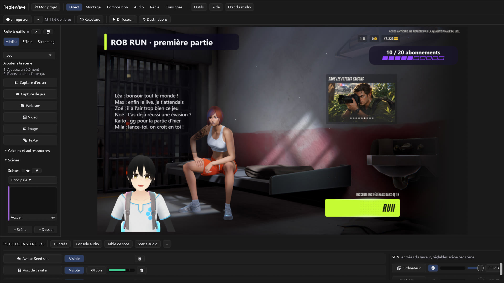
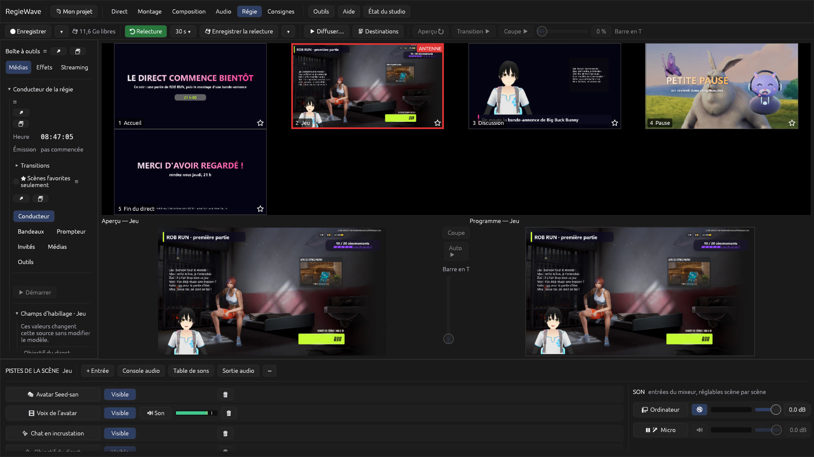
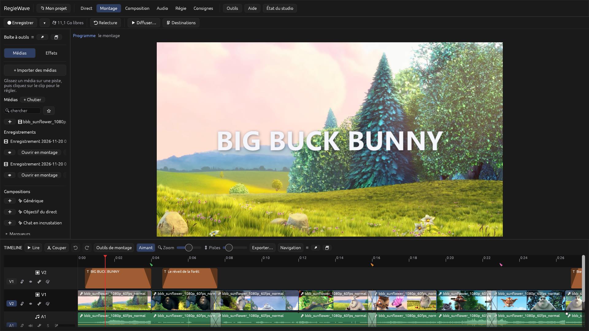
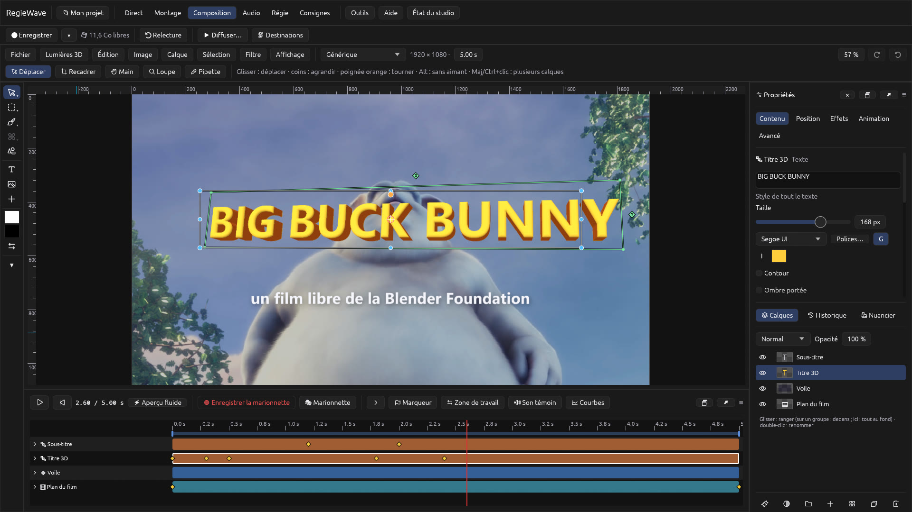

# RegieWave

Logiciel tout-en-un pour Windows et Linux : **direct** (comme OBS), **régie**,
**montage**, **composition** et **son**.

[](https://faelnor92.github.io/regiewave/#video)

**[Voir la vidéo de présentation (1 minute)](https://faelnor92.github.io/regiewave/#video)**
· [Site de RegieWave](https://faelnor92.github.io/regiewave/)
· [Manuel](https://faelnor92.github.io/regiewave/manuel/)

> **⚠️ Version alpha.** RegieWave est encore en développement : beaucoup de
> fonctions n'ont été essayées que sur un seul ordinateur, pas encore avec
> tous les modèles de webcams, micros, cartes graphiques et services de
> diffusion. Attendez-vous à des erreurs ou à des fermetures inattendues.
> Faites un essai avant un direct ou un enregistrement important, gardez une
> copie de vos projets (un projet ouvert dans une version plus récente ne
> s'ouvre plus dans une plus ancienne), et
> [signalez les problèmes](https://github.com/faelnor92/regiewave/issues).
>
> **Alpha version.** RegieWave is still in development: expect bugs. Test
> before an important live show, keep a copy of your projects, and
> [report problems](https://github.com/faelnor92/regiewave/issues).

Ce dépôt sert seulement à **publier les versions** de RegieWave : l'installateur
Windows et l'AppImage Linux sont dans
[Releases](https://github.com/faelnor92/regiewave/releases). Sous Windows,
RegieWave y cherche lui-même ses mises à jour (Outils → Mises à jour…), les
télécharge, vérifie leur empreinte SHA-256 donnée par GitHub, puis les
installe en gardant la version précédente pour pouvoir y revenir. Sous Linux,
téléchargez la nouvelle AppImage et remplacez l'ancienne.

## En images

| | |
|---|---|
| [](docs/assets/img/direct.jpg) | [](docs/assets/img/regie.jpg) |
| **Direct** : capture de jeu, avatar qui suit la voix, chat et objectif d'abonnés, plusieurs destinations à la fois. | **Régie** : multivue de toutes les scènes, aperçu et programme, barre en T, transitions. |
| [](docs/assets/img/montage.jpg) | [](docs/assets/img/composition.jpg) |
| **Montage** : plans, titres, fondus et son, tout à la souris ; export H.264, HEVC, AV1, ProRes. | **Composition** : titres 3D en relief, lumières, images clés, retouche photo. |

Images et vidéo faites avec RegieWave. Film : *Big Buck Bunny*
© Blender Foundation, [peach.blender.org](https://peach.blender.org/)
(licence CC-BY 3.0). Avatar : *Seed-san* © VirtualCast, Inc. (VRM Public
License 1.0). Jeu : menu de *ROB RUN*, droits à son éditeur. RegieWave n'est
lié ni à OBS, ni à Twitch, ni aux auteurs de ces œuvres.

## Installer

### Windows

1. Dans la [dernière version](https://github.com/faelnor92/regiewave/releases/latest),
   téléchargez `RegieWave-<version>-installation.exe`.
2. Lancez-le et choisissez :
   - **pour tous les utilisateurs** (conseillé) : droits d'administrateur,
     caméra virtuelle comprise ;
   - **pour moi seulement** : sans droits d'administrateur ni caméra
     virtuelle.
3. Lisez l'avertissement de la version alpha, puis acceptez les conditions
   d'utilisation.

Windows 10 (version 1809) ou plus récent, 64 bits. Tout ce dont RegieWave a
besoin est inclus (FFmpeg, Chromium pour les pages web, runtime Visual C++).
L'installateur n'est pas encore signé : Windows SmartScreen peut afficher un
avertissement au premier lancement (« Informations complémentaires » →
« Exécuter quand même »).

### Linux (AppImage)

1. Dans la [dernière version](https://github.com/faelnor92/regiewave/releases/latest),
   téléchargez `RegieWave-<version>-x86_64.AppImage`.
2. Rendez-le exécutable puis lancez-le :

   ```sh
   chmod +x RegieWave-*-x86_64.AppImage
   ./RegieWave-*-x86_64.AppImage
   ```

   Sans FUSE sur votre système : `./RegieWave-*-x86_64.AppImage --appimage-extract-and-run`.

Linux 64 bits récent (glibc 2.36 ou plus : Debian 12, Ubuntu 23.04,
Fedora 37…). Un seul fichier, sans installation : FFmpeg et Chromium (pour les
pages web) y sont inclus ; PipeWire, Vulkan et les pilotes graphiques sont ceux
de votre ordinateur. Vérifiez le fichier avec `sha256sum` : l'empreinte est
affichée sur la page de la version.

## Signaler un problème

Ouvrez un ticket dans [Issues](https://github.com/faelnor92/regiewave/issues)
en décrivant ce que vous faisiez et ce qui s'est passé. Dans RegieWave,
**Aide → Créer un rapport** prépare un fichier à joindre : version,
Windows, carte graphique, réglages et fin des journaux, **sans** clé de
diffusion ni mot de passe.

## Conditions d'utilisation

RegieWave est **gratuit**, et ce que vous créez avec vous appartient (y
compris pour le monétiser). Il n'envoie aucune donnée à son auteur. Il ne
peut pas être vendu ni distribué ailleurs que sur cette page, et il est
fourni sans garantie. Le texte complet est montré par l'installateur et
gardé dans le dossier `licences` de l'installation.

## Logiciels inclus et licences

Leurs licences sont dans le dossier `licences` de l'installation (Windows) ou
dans `usr/share/licenses/regiewave` de l'AppImage (Linux).

- **FFmpeg 7.1** (LGPL 3, avec le texte de la GPL 3 qu'elle complète), en
  bibliothèques séparées (`av*.dll`, `sw*.dll`) que l'on peut remplacer, et
  `ffmpeg.exe`. Version `n7.1-214-g71889a8437`, compilée par
  [BtbN/FFmpeg-Builds](https://github.com/BtbN/FFmpeg-Builds)
  (`autobuild-2025-02-28-13-02`, variante `win64-lgpl-shared-7.1`). Code
  source : [FFmpeg 71889a8437](https://github.com/FFmpeg/FFmpeg/tree/71889a8437).
- **Chromium Embedded Framework** et **Chromium** (licence BSD et licences
  des composants de Chromium : `licences/Chromium.html`).
- **Runtime Visual C++** de Microsoft (redistribuable).
- **DeepFilterNet** (isolation de la voix), **YuNet** (suivi du visage),
  **pyaaf2** (dictionnaire AAF) : licence MIT. **MediaPipe Selfie
  Segmentation** (détourage d'une personne) : licence Apache 2.0.
- Les **bibliothèques Rust** compilées dans le programme (licences MIT,
  Apache, BSD et apparentées) : tous leurs textes de licence sont dans
  `licences/Bibliothèques Rust.txt`.
